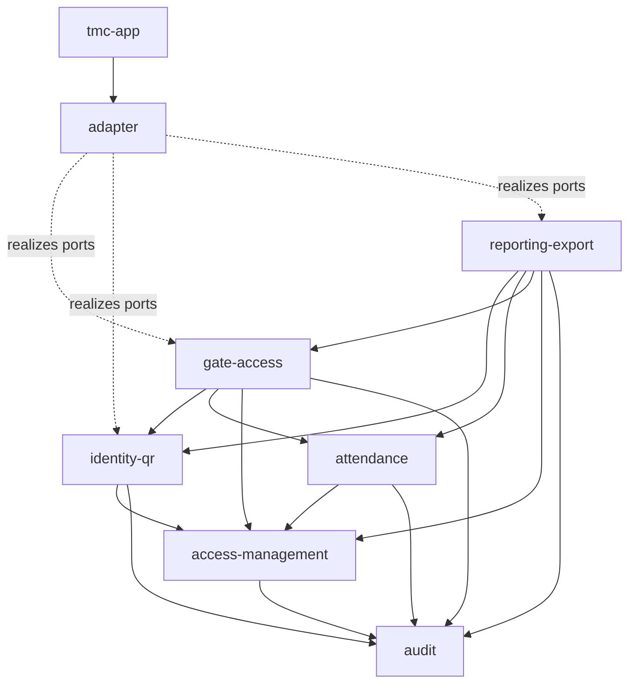

# TMC QR Attendance & Access Control System — Backend

Course project for **Software Architecture (CO3017)**, HCMUT. Back end of a QR-code-based attendance and
access-control system for TMC Manufacturing (Binh Duong and Long An factories).

> **Status: skeleton.** The repository currently contains the build setup, the complete module, layer and
> package structure, empty class/interface declarations (each with Javadoc linking it to the report),
> placeholder migrations, and **executable architecture tests**. Business logic is implemented in Milestone 2
> (see [CONTRIBUTING.md](CONTRIBUTING.md)).

---

## 1. Tech stack

| Concern | Choice | Why (report reference) |
|---|---|---|
| Language | **Java 21 (LTS)** | Interfaces, records and sealed types map 1:1 to the ports, public interfaces and value types of the class diagrams (§8.1). |
| Framework | **Spring Boot 3.5** | Constructor dependency injection (DIP, §5.1.5), declarative transactions for the gate-flow Unit of Work (ADR-02), scheduling for the monthly export (ADR-05), Spring Security for RBAC (ADR-06). |
| Build | **Maven multi-module** (+ Maven Wrapper `./mvnw`) | Each architecture module is its own Maven module, so the allowed dependencies of Figure 1 are declared explicitly and **cycles are rejected at build time** (dependency rule 3). |
| Architecture enforcement | **ArchUnit 1.3** | Executes the dependency rules of §3.3.1 as tests, as required by ADR-01 ("module boundaries must be checked in review and tests"). |
| Central database | **PostgreSQL 16** | One transactional database, one schema per module (§3.3.2); supports triggers (append-only audit, ADR-06), partial unique indexes and synchronous standby replication (ADR-08). |
| Schema migration | **Flyway** | Each module ships the migrations of its own schema only (data ownership, rule 2). |
| Kiosk local store | **SQLite** (WAL, `synchronous=FULL`) | Durable outbox and offline cache on the gate kiosk (ADR-03, E2, §8.2). |
| Token cryptography | **Ed25519** (JDK built-in) | Device-bound rotating QR (§6.2.4, RFC 8032). |
| Packaging / runtime | **Docker** image `tmc-app` + docker-compose | One deployable unit on two identical servers; no Kubernetes (ADR-08). |
| Testing | JUnit 5, Spring Boot Test, ArchUnit | — |

---

## 2. Architecture at a glance

The system has **two architecture quanta** (§3.1.2), and each one is a separate deployable unit in this repository:

| Quantum | Deployable | Style | Decision |
|---|---|---|---|
| Central application | `central/tmc-app` → Docker image `tmc-app` | **Modular monolith with layered modules**: 7 modules partitioned by business domain, each with a public interface and three internal layers | ADR-01 |
| Gate kiosk | `kiosk/kiosk-app` | Autonomous edge component: State pattern (Online / Offline / Syncing), durable outbox, local cache | ADR-03 |

Supporting patterns inside the style (§3.2.3), and where each one lives in the code:

| Pattern | Location |
|---|---|
| Ports & Adapters | `*/persistence/port/*Port` (owned by the domain module) ← `central/modules/adapter/*Adapter` |
| Pipeline (monthly export) | `reportingexport/business/export/` (`ExportPipeline`, `ExportFilter`, `filter/*`) |
| Store-and-forward + idempotent receiver | kiosk `port/Outbox` + `infrastructure/SqliteOutbox`; server `gateaccess/.../KioskSyncService`, PK `event_id` |
| Unit of Work | `shared/shared-kernel/.../tx/UnitOfWork` ← `tmc-app/.../TransactionTemplateUnitOfWork` |
| Chain of checks (Strategy) | `shared/qr-token-lib/.../validation/QrTokenValidator` + `check/*Check` (V1–V5) |
| Strategy (anti-passback V6) | `gateaccess/business/policy/PassbackPolicy` |
| State | kiosk `application/ConnectionStateMachine`, `KioskState`, `OnlineState`, `OfflineState`, `SyncingState` |
| Facade (single module entry point) | `*/business/*Facade` |

---

## 3. Repository structure

```text
.
├── pom.xml                         # root reactor (Spring Boot parent, module list, versions)
├── mvnw, mvnw.cmd, .mvn/           # Maven Wrapper — no local Maven install needed
├── docker-compose.yml              # postgres + tmc-app (+ kiosk with --profile kiosk)
├── docker/                         # tmc-app.Dockerfile, kiosk.Dockerfile
├── architecture/adr/               # Architecture Decision Records (ADR-01..08 + template)
│
├── shared/
│   ├── shared-kernel/              # value types (Table 25), EventId, Clock, UnitOfWork — depends on nothing
│   └── qr-token-lib/               # token parser, validator, checks V1–V5, SPI (§8.1.2) — reused by server AND kiosk
│
├── central/                        # ── QUANTUM 1: central application (modular monolith) ──
│   ├── modules/
│   │   ├── audit/                  # cross-cutting   FR-4.4
│   │   ├── access-management/      # cross-cutting   FR-5.1, 5.2, 5.5, FR-6.x
│   │   ├── identity-qr/            # domain          FR-1.x, FR-7.1–7.3
│   │   ├── attendance/             # domain          FR-3.x
│   │   ├── gate-access/            # domain          FR-2.x, FR-5.3, FR-7.4–7.6
│   │   ├── reporting-export/       # domain          FR-4.1–4.3, 4.5–4.7
│   │   └── adapter/                # integration     IC-1, IC-2, FR-1.3
│   └── tmc-app/                    # composition root + application.yml + ARCHITECTURE TESTS
│
└── kiosk/                          # ── QUANTUM 2: gate kiosk (edge) ──
    └── kiosk-app/
```

### 3.1 Inside a module (same shape for every domain and cross-cutting module)

Example: `central/modules/gate-access/src/main/java/vn/tmc/gateaccess/`

```text
gateaccess/
├── package-info.java      # module description: owned FRs, allowed dependencies
├── api/                   # PUBLIC INTERFACE — the only package other modules may use (Table 6)
│   ├── GateStatusApi.java
│   └── dto/
├── presentation/          # LAYER 1: controllers / scheduled triggers
│   ├── GateController.java          (ScanApi)
│   └── KioskSyncController.java     (ScanApi additions: sync, snapshot, heartbeat)
├── business/              # LAYER 2: facade (single entry point) + services
│   ├── GateAccessFacade.java
│   ├── GateStatusFacade.java        implements GateStatusApi
│   ├── service/                     AccessDecisionService, KioskSyncService, GateStationService, ...
│   └── policy/                      PassbackPolicy (Strategy)
├── persistence/           # LAYER 3: repositories, entities, ports
│   ├── repository/                  GateStationRepository, KioskRepository
│   ├── entity/
│   └── port/                        TurnstilePort, SecurityAlertPort   (implemented by Adapter module)
└── config/                # module-local configuration (FR-5.4)
src/main/resources/db/migration/gate_access/   # this module's schema only
```

Deviations, each taken directly from the report:

* **Audit** has no `presentation` layer; inspection is offered by Reporting & Export (Table 12).
* **Reporting & Export** has no `api` package: no module may depend on it (rule 3).
* **Adapter** has no layers: one sub-package per external system (Table 13).

---

## 4. Mapping: report → code

### 4.1 Modules (Table 5) and interfaces / ports (Table 6)

| Report element | Maven module | Package root | Public interface (`api`) | Ports (`persistence.port`) |
|---|---|---|---|---|
| Identity & QR | `central/modules/identity-qr` | `vn.tmc.identityqr` | `IdentityQrApi` | `QrDeliveryPort` |
| Gate Access | `central/modules/gate-access` | `vn.tmc.gateaccess` | `GateStatusApi` (§8.1.5) | `TurnstilePort`, `SecurityAlertPort` |
| Attendance | `central/modules/attendance` | `vn.tmc.attendance` | `AttendanceApi` | — |
| Reporting & Export | `central/modules/reporting-export` | `vn.tmc.reportingexport` | *none* | `PayrollExportPort` |
| Access Management | `central/modules/access-management` | `vn.tmc.accessmanagement` | `AuthorizationApi` | — |
| Audit | `central/modules/audit` | `vn.tmc.audit` | `AuditApi` | — |
| Adapter module | `central/modules/adapter` | `vn.tmc.adapter` | — | realizes all ports: `HttpTurnstileAdapter`, `MockTurnstileAdapter`, `HrPayrollAdapter`, `QrDeliveryAdapter`, `SecurityAlertAdapter` |

### 4.2 Module dependency graph (Figure 1), as declared in the pom files



### 4.3 Runtime flows → classes

| Flow (report) | Entry point | Coordinator |
|---|---|---|
| Flow A: QR scan (Fig. 10, §8.1.1) | `gateaccess.presentation.GateController` | `gateaccess.business.service.AccessDecisionService` |
| Flow B: monthly export (Fig. 11) | `reportingexport.presentation.ExportJobTrigger` | `reportingexport.business.service.PayrollExportService` → `ExportPipeline` |
| Kiosk resync (Fig. 15, §8.1.5) | `gateaccess.presentation.KioskSyncController` | `gateaccess.business.service.KioskSyncService` |
| Device enrollment (Fig. 17, §8.1.3) | `identityqr.presentation.IdentityQrController` | `identityqr.business.service.CredentialService`, `SigningKeyService` |
| Token validation V1–V5 (Fig. 18, §8.1.2) | `IdentityQrApi.validateToken` | `qrtoken.validation.QrTokenValidator` |
| Kiosk state machine (Fig. 16, §8.1.4) | `kiosk.presentation.ScanInputListener` | `kiosk.application.ConnectionStateMachine` |

### 4.4 Architecture decisions → where they are visible

| ADR | Visible in |
|---|---|
| ADR-01 Modular monolith | Maven modules under `central/modules`, single `tmc-app` jar/image, `ModuleBoundaryTest` |
| ADR-02 Record + audit in one transaction | `UnitOfWork` (shared kernel), `TransactionTemplateUnitOfWork`, `AccessDecisionService` |
| ADR-03 Kiosk offline mode | `kiosk/kiosk-app` (State pattern, `Outbox`, `LocalCache`), `KioskArchitectureTest` |
| ADR-04 Turnstile port + adapter | `TurnstilePort` ← `HttpTurnstileAdapter` / `MockTurnstileAdapter` |
| ADR-05 Async monthly export | `ExportJobTrigger`, `business/export` pipeline, `ExportLockRepository` |
| ADR-06 Central RBAC + append-only audit | `access-management` module, `SecurityConfig`, `audit_log` trigger (V100 migration) |
| ADR-07 Personal-data protection | schema per module, `ConventionTest.publicInterfacesDoNotExposeEntities`, scope checks in `ReportService` |
| ADR-08 Two app servers + standby DB | stateless `tmc-app` image, `docker/`, actuator health endpoint |

Full text: [architecture/adr/](architecture/adr/).

### 4.5 Database ownership (Table 27)

| Schema (owner) | Migration folder | Tables |
|---|---|---|
| `identity_qr` | `identity-qr/src/main/resources/db/migration/identity_qr` | employee, device_credential, signing_key, used_nonce |
| `gate_access` | `gate-access/.../db/migration/gate_access` | gate_station, kiosk |
| `attendance` | `attendance/.../db/migration/attendance` | attendance_event |
| `audit` | `audit/.../db/migration/audit` | audit_log (append-only trigger) |
| `access_management` | `access-management/.../db/migration/access_management` | user_account, role, permission, … |
| `reporting_export` | `reporting-export/.../db/migration/reporting_export` | export_batch, export_lock |
| kiosk (SQLite) | `kiosk-app/src/main/resources/db/kiosk-schema.sql` | outbox_event, cached_signing_key, revoked_credential, cache_meta, seen_nonce |

Flyway version ranges prevent collisions between modules: audit `V1xx`, access_management `V2xx`,
identity_qr `V3xx`, gate_access `V4xx`, attendance `V5xx`, reporting_export `V6xx`.
There are no foreign keys between schemas; references across modules are logical only (§8.2).

---

## 5. Architecture rules and how they are enforced

| # | Rule (report §3.3.1 / ADR) | Enforced by |
|---|---|---|
| R1 | A module is called only through its public interface (`api`) | `ModuleBoundaryTest.moduleInternalsArePrivate` |
| R2 | A module reads and writes only its own tables | one schema + migration folder per module; repositories are module-internal (R1) |
| R3 | Dependencies are acyclic; no module depends on Reporting & Export | Maven reactor (compile-time), `modulesAreFreeOfCycles`, `noModuleDependsOnReportingExport` |
| R4 | Inside a module each layer calls only the layer below; the facade is the single entry point | `LayerDependencyTest` (4 rules × 6 modules) |
| R5 | External systems are reached only through ports implemented by the Adapter module | `portsAreOnlyRealizedByAdapters`, `noModuleDependsOnAdapters`, `adaptersDependOnlyOnPorts` |
| R6 | Audit depends on no module; Access Management depends only on Audit | `auditDependsOnNoModule`, `accessManagementDependsOnlyOnAudit` + pom files |
| R7 | Public interfaces and ports are Java interfaces; entities never leak through `api` | `ConventionTest` |
| R8 | The kiosk never depends on central modules; its application layer depends on ports, not on infrastructure | `KioskArchitectureTest` |

`./mvnw verify` fails if any rule is broken.

---

## 6. SOLID in the structure (§5.1, Table 26)

| Principle | Where it is visible in the structure |
|---|---|
| **S**RP | one module per business capability; one focused service per responsibility (`business/service/*`); one class per token check (`check/*Check`) |
| **O**CP | new external system → new adapter; new validation rule → new `TokenCheck`; new export step → new `ExportFilter`; new kiosk state → new `KioskState` |
| **L**SP | `HttpTurnstileAdapter` ↔ `MockTurnstileAdapter` (same `TurnstilePort` contract); `DbNonceRepository` ↔ `LocalNonceStore`; `DbCredentialStatusSource` ↔ `LocalCache` |
| **I**SP | small public interfaces per capability (`IdentityQrApi`, `AttendanceApi`, `AuthorizationApi`, `AuditApi`, `GateStatusApi`); small SPIs in `qr-token-lib/spi` |
| **D**IP | services depend on `api` interfaces and ports, injected through the constructor; `Clock` and `UnitOfWork` are abstractions in the shared kernel; adapters depend on ports, not the other way round |

---

## 7. Build and run

Requirements: **JDK 21** (for example `sudo dnf install java-21-openjdk-devel`) and Docker. Maven is not required (use `./mvnw`).

```bash
./mvnw verify                          # compile all modules + run architecture tests
docker compose up -d postgres          # database only
./mvnw -pl central/tmc-app -am spring-boot:run
docker compose up --build              # postgres + tmc-app in containers
docker compose --profile kiosk up      # + one kiosk
```

Without a local JDK, build inside the same image the Dockerfile uses:

```bash
docker run --rm -v tmc-m2:/root/.m2 -v "$PWD":/src -w /src maven:3.9.9-eclipse-temurin-21 mvn -B verify
```

---

## 8. Team

| Student | ID |
|---|---|
| Nguyễn Minh Hưng | 2352436 |
| Đàm Hoài An | 2352002 |
| Đỗ Đăng Khoa | 2352554 |
| Nguyễn Thành Tài | 2353062 |
| Phạm Minh Tuân | 2353265 |
| Đinh An Huy | 2352372 |

Lecturer: Trương Thị Thái Minh.
